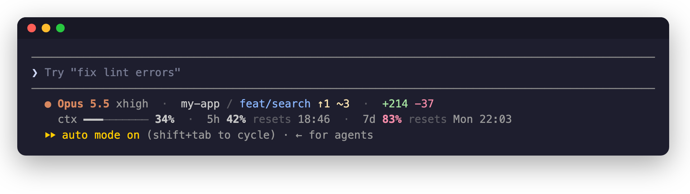

<div align="center">
  <h1>Claude Statusline</h1>
  <p>
    <a href="https://github.com/nagameTW/claude-statusline-sh/actions/workflows/ci.yml"></a>
    <a href="./LICENSE"></a>
    <a href="#requirements"></a>
  </p>
</div>

A quiet, two-line statusline for [Claude Code](https://code.claude.com/docs/en/statusline). It is one bash script. The only dependency is `jq`.



Colour shows state. A usage meter is grey while usage is fine, yellow from 60% and red from 80%. Only the number that needs your attention stands out.

## What it shows

- Line 1: the model, its effort level, the project and the git branch. It also shows `fast` when fast mode is on, and the lines Claude has added and removed.
- Line 2: the context usage and the 5-hour and weekly limits with their reset times. It shows `cache cold` when the prompt cache has expired.

Next to the branch, `↑2` means two commits to push, `↓1` means one commit to pull, and `~3` means three changed files. [What it shows](docs/what-it-shows.md) explains each item, including why the line count does not match `git diff`.

## Requirements

- bash 3.2 or newer. The `/bin/bash` that macOS ships works.
- `jq`.
- macOS, Linux, WSL, or Windows with Git Bash ([platforms](docs/platforms.md)).

## Install

Download the script.

```sh
curl -fsSL https://raw.githubusercontent.com/nagameTW/claude-statusline-sh/main/claude-statusline.sh -o ~/.claude/claude-statusline.sh
```

Then add it to `~/.claude/settings.json`.

```json
{
  "statusLine": {
    "type": "command",
    "command": "bash \"$HOME\"/.claude/claude-statusline.sh",
    "refreshInterval": 2
  }
}
```

Keep `refreshInterval`. Claude Code reruns a status line only when something happens in the session, and a terminal resize does not count. Without it, a split pane keeps the old, wider line, and Claude Code cuts it off at the edge. A rerun every 2 seconds also shows git changes made outside the session. Each run takes about 20 ms.

## Configuration

- `NO_COLOR=1` turns colour off.
- `CLAUDE_STATUSLINE_THEME=light` or `dark` sets the palette.

Put either one before `bash` in the `command` line. [Configuration](docs/configuration.md) has the other options, the colours, and the behavior in narrow terminals.

## Repository structure

```
├── claude-statusline.sh       # The statusline script
├── test.sh                    # Tests with fixed inputs
├── docs/
│   ├── what-it-shows.md       #   Every item on both lines
│   ├── configuration.md       #   Options, colours, narrow terminals
│   ├── platforms.md           #   macOS, Linux, WSL, Windows
│   └── *.png                  #   Images used by the pages
├── .github/                   # CI, issue and PR templates
├── CHANGELOG.md               # Changes per version
└── LICENSE
```

## Development

```sh
./test.sh
shellcheck claude-statusline.sh test.sh
```

CI runs the tests on Linux, macOS and Windows. To try one input by hand:

```sh
echo '{"model":{"display_name":"Opus 5.5"},"context_window":{"used_percentage":42}}' | bash claude-statusline.sh
```

To report a bug or request a feature, use the [bug report](../../issues/new?template=bug_report.yml) or [feature request](../../issues/new?template=feature_request.yml) form.

For themes, Powerline glyphs or a configuration UI, use [ccstatusline](https://github.com/sirmalloc/ccstatusline). It does more. This project is for people who prefer to read one small file.

## License

[MIT](LICENSE). This project is not affiliated with Anthropic.
