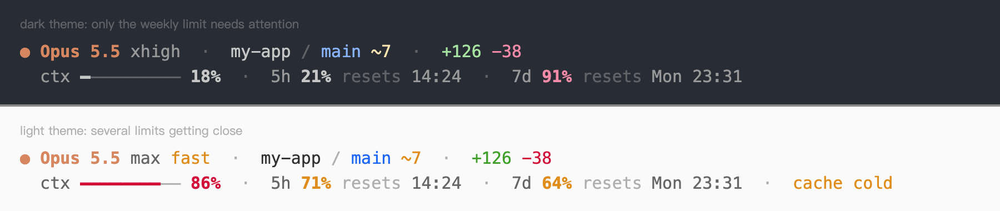
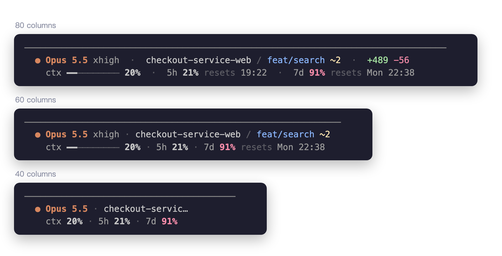

# Configuration

The thresholds and colours are constants at the top of `claude-statusline.sh`. The file is short, so editing it is the configuration.

## Options

- `NO_COLOR=1` turns colour off, following [no-color.org](https://no-color.org). Put it in the command: `"command": "NO_COLOR=1 bash \"$HOME\"/.claude/claude-statusline.sh"`.
- `CLAUDE_STATUSLINE_THEME=light` or `dark` sets the palette when the automatic choice is wrong. See [Colours](#colours).
- Git information is cached for 5 seconds per directory in `~/.cache/claude-statusline-sh`. If `$XDG_CACHE_HOME` is set, the cache is in `$XDG_CACHE_HOME/claude-statusline-sh`.

## Colours

Claude Code draws the whole status line in its own grey, and it turns "default colour" back into that grey. The script builds three shades on top of it:

- A brighter grey for names and values.
- Claude Code's grey for labels.
- A dim grey for separators and the word "resets".

The state colours (yellow, red, blue and green) come from the palette of your terminal. The model name is always orange.

The brighter grey must be darker on a light background. The script reads the `theme` setting in `~/.claude.json` and switches to a dark grey for the light themes. If you use the `auto` theme on a light terminal, set `CLAUDE_STATUSLINE_THEME=light` in the command.

## Narrow terminals

In a split pane, each line gives up details one at a time. It does not cut off whatever is on the right.

1. The gaps tighten first.
2. Line 1 drops the line counts, the effort level, the end of a long project name, and then the branch.
3. Line 2 drops the reset times of meters that are fine and then the context bar. Last, it drops the reset time of a meter that needs attention.

All three percentages stay on screen down to about 35 columns. This needs the `refreshInterval` from the [install step](../README.md#install), because a resize alone does not rerun the script.

